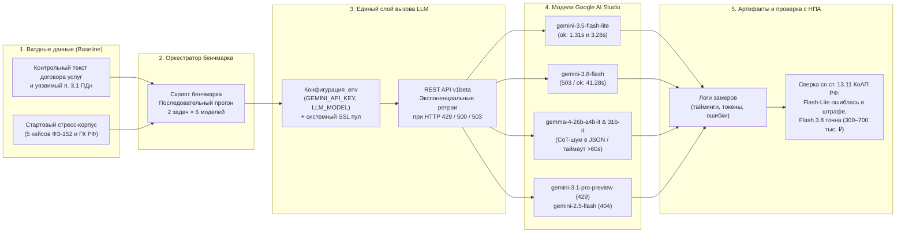
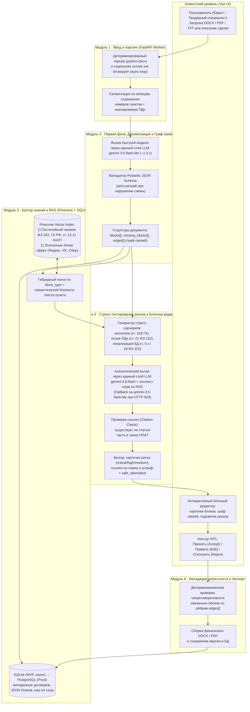

# ML System Design Doc — [RU]

## Дизайн ML-системы — Модульный конструктор договоров · MVP · v1.0

*Дизайн-документ подготовлен на основе [шаблона ML System Design Doc от Reliable ML](https://github.com/IrinaGoloshchapova/ml_system_design_doc_ru/blob/main/ML_System_Design_Doc_Template.md) и материалов курса «Проектирование систем машинного обучения» (Занятие 1, Экономика и метрики ML-решений, Данные в ML-системе, Схемы валидации, Оценка и валидация LLM-систем).*

- **Автор (`Data Scientist` / `ML Engineer`):** Новиков Тимофей Витальевич
- **Роль `Product Owner` / доменный эксперт:** Юрист-лидер проекта (валидация порогов метрик и эталонных стресс-примеров запланирована на Итерацию 2)

> ### Термины и пояснения
> - **Итерация** — все исследовательские, инженерные и организационные работы, которые совершаются до старта очередного пилота (Итерация 1 — исследование рынка, подключение моделей, базовый стресс-корпус и проектирование модульной декомпозиции; Итерация 2 — постатейный RAG в Pinecone, FastAPI бэкенд и экспертная валидация с юристом-лидером).
> - **БТ** — бизнес-требования.
> - **EDA** — Exploratory Data Analysis — исследовательский анализ данных и экспериментальный бенчмарк моделей.
> - **ПДн** — персональные данные (регулируются Федеральным законом от 27.07.2006 № 152-ФЗ «О персональных данных»).
> - **НПА** — нормативно-правовые акты РФ (ФЗ-152, ГК РФ ч. 1 и 2, ст. 13.11 КоАП РФ).
> - **HITL (Human-in-the-Loop)** — участие человека (юриста / специалиста тендерного отдела) в контуре проверки и принятия предложенных ИИ правок договора.
> - **RAG (Retrieval-Augmented Generation)** — генерация ответа LLM с опорой на извлечённые фрагменты актуальных редакций законов и эталонных юридических формулировок.
> - **[Маркировка `На согласовании с PO`]** — в соответствии с рекомендациями [ML System Design Doc Workflow](https://github.com/IrinaGoloshchapova/ml_system_design_doc_ru/blob/main/ML_System_Design_Doc_Workflow.md), расчётные финансовые допущения и пороговые значения метрик явно выделены для финального утверждения на интервью с бизнес-заказчиком (юристом-лидером).

---

## 1. Цели и предпосылки

### 1.1. Зачем идем в разработку продукта?

#### Бизнес-цель (`Product Owner`)
Сократить трудозатраты специалистов малого и среднего бизнеса (МСБ) и тендерных отделов на подготовку и первичную вычитку договоров и документов по персональным данным в **3–4 раза** (с 30–40 минут до **≤ 5–8 минут** на документ) и снизить регуляторные и финансовые риски бизнеса (штрафы по ст. 13.11 КоАП РФ от **300 000 до 700 000 руб.** по ч. 2 и от **1 000 000 до 6 000 000 руб.** по ч. 8, а также потери из-за кабальных условий оплаты по ст. 328, 330, 781 ГК РФ) за счёт создания веб-конструктора договоров на уровне связанных смысловых блоков с RAG-проверкой по праву РФ и автоматическим стресс-тестированием конфликтных сценариев.

#### Почему станет лучше, чем сейчас, от использования ML / LLM (`Product Owner` & `Data Scientist`)
- **Проблема текущего процесса (Baseline A — ручной процесс):** По данным отраслевых исследований (в т.ч. Контур.Фокус), до **40% рабочего времени** специалистов, работающих с контрактами, уходит на первичную вычитку договоров контрагентов. В МСБ и при подготовке тендерных контрактов договоры собираются копированием старых шаблонов Word (`DOCX`). При ручной правке одного раздела (например, срока оплаты) часто возникает рассинхрон с разделом ответственности и порядком расторжения или приостановки работ, а устаревшие формулировки согласий и политик ПДн несут прямые риски штрафов.
- **Почему недостаточно существующих альтернатив на рынке (мета-анализ 5 решений):**
  1. *Ручной процесс (папка шаблонов Word + СПС КонсультантПлюс):* высокая точность при привлечении профильного юриста, но долго (30–60 мин на документ) и дорого, высокий риск человеческой ошибки при проверке перекрёстных ссылок.
  2. *Spellbook (`spellbook.legal`, Word Add-In, США/Канада):* эффективно использует концепцию Playbooks и точечный redline внутри MS Word, но анализирует текст линейно (как плоский документ без графа межблочных связей) и не адаптирован под право РФ (ФЗ-152, ГК РФ).
  3. *Harvey AI (`harvey.ai`, Enterprise Legal Platform, США):* глубокий мультиагентный анализ и Vault для глобальных корпораций (Fortune 500), но закрытая продажа и высокий порог входа делают решение недоступным для российского МСБ.
  4. *Российские ИИ-чекеры договоров (Контур.Фокус «ИИ-анализ договоров», Law2You):* быстро проверяют чужой готовый договор перед подписанием (скоринг рисков за 3–5 минут: высокий / средний / низкий и выгрузка протокола разногласий), но работают постфактум с плоским текстом и не являются модульным конструктором со стресс-симуляцией споров.
- **В чём преимущество предлагаемого ML/LLM-решения (УТП):** Вместо генерации «сплошного текста» (где LLM склонна галлюцинировать нормами или терять обязательные условия) система:
  1. Декомпозирует документ на типизированные смысловые блоки и строит **граф логических зависимостей** между ними (например, `Срок оплаты` ↔ `Неустойка за просрочку` ↔ `Право на приостановку услуг по ст. 328 ГК РФ`).
  2. Подтягивает точные статьи и части НПА РФ из векторного индекса **Pinecone (RAG)**, устраняя галлюцинации в санкциях и номерах статей (что экспериментально доказано при сверке ч. 2 ст. 13.11 КоАП РФ).
  3. Прогоняет каждый блок через **стресс-тестирование конфликтных сценариев** («Заказчик задержал оплату», «Утечка / трансграничная передача ПДн», «Отзыв согласия на обработку ПДн», «Односторонний отказ»).

#### Причинная цепочка ценности (от проблемы до P&L)
Согласно методологии экономики ML-решений («Если после прогноза никто не действует иначе, ценность модели равна нулю»):
$$\text{Проблема (ручная вычитка 30–40 мин + риск штрафов)} \longrightarrow \text{Решение (декомпозиция + RAG + стресс-тест)} \longrightarrow \text{Действие (юрист принимает/правит безопасную редакцию блока в UI)} \longrightarrow \text{Эффект (время сборки }\le 5\text{–}8\text{ мин, устранены уязвимости)} \longrightarrow \text{Деньги (высвобождение мощности / экономия ФОТ + предотвращённый ожидаемый ущерб от штрафов и неплатежей)}$$

#### Что будем считать успехом итерации с точки зрения бизнеса (`Product Owner`)
1. **Для исследовательской итерации (Итерация 1 — PoC):**
   - Сформирована модульная архитектура из 6 компонентов и реализован единый отказоустойчивый слой вызова LLM.
   - Проведено тестирование 6 моделей семейств Gemini и Gemma на задачах декомпозиции (`decompose`) и анализа рисков (`risk_152fz`), обоснован каскадный выбор моделей (`gemini-3.5-flash-lite` + `gemini-3.8-flash` с RAG).
   - Подготовлен стартовый верифицированный стресс-корпус из 5 русскоязычных кейсов по ФЗ-152 и ГК РФ с эталонными безопасными формулировками (`safe_alternative`).
2. **Для итерации MVP и пилота (Итерация 2):**
   - Достижение целевых показателей на расширенном корпусе (15–30+ документов) и подтверждение экспертом (юристом-лидером):
     - Точность декомпозиции договора на блоки (Macro-F1 / совпадение с разметкой юриста) $\ge 0{,}85$.
     - Полнота выявления заложенных рисков (Risk Recall на стресс-корпусе) $\ge 0{,}80$.
     - Доля предложенных ИИ-редакций блоков, принятых юристом без ручного переписывания (Acceptance Rate) $\ge 0{,}70$.
     - Сокращение полного цикла сборки и проверки документа (включая HITL-проверку человеком) в **3–4 раза** — до $\le 5\text{–}8$ минут.

---

### 1.2. Бизнес-требования и ограничения

#### Краткое описание бизнес-требований (БТ) (`Product Owner`)
Основные функциональные бизнес-требования к системе:
- **БТ-1 (Ввод и парсинг документов):** Система должна принимать на вход договоры и политики в форматах `.docx` / `.txt` (а также `.pdf` или текстовое описание сделки), очищать текст и сохранять исходную нумерацию разделов и пунктов.
- **БТ-2 (Модульная декомпозиция и граф связей — Первая фича):** Автоматическое разбиение документа на типовые смысловые блоки (Предмет, Цели и объём ПДн, Сроки хранения, Передача третьим лицам, Трансграничная передача, Отзыв согласия, Цена и порядок расчётов, Ответственность, Споры, Конфиденциальность), выявление пропущенных обязательных разделов (`missing_blocks[]`) и построение матрицы межблочных зависимостей (`edges[]`).
- **БТ-3 (Блочное редактирование с опорой на RAG по праву РФ):** При редактировании выбранного блока система должна находить релевантные статьи НПА РФ (ФЗ-152, ГК РФ, ст. 13.11 КоАП РФ) и эталонные шаблоны из векторного хранилища, предлагая безопасную альтернативную редакцию (`safe_alternative`) с точной ссылкой на норму закона.
- **БТ-4 (Стресс-тестирование конфликтных сценариев):** Моделирование последствий типовых конфликтов сторон сделки («Заказчик задержал оплату более чем на 5 рабочих дней», «Субъект ПДн направил отзыв согласия», «Роскомнадзор проверяет локализацию БД») с ранжированием уязвимостей по критичности (`critical`, `high`, `medium`).
- **БТ-5 (Валидация целостности и экспорт):** Финальная проверка непротиворечивости блоков между собой и детерминированная выгрузка готового документа в `.docx` / `.pdf` с сохранением версии в БД.

#### Бизнес-ограничения и технические ограничения (`Product Owner` & `Data Scientist`)
1. **Правовая юрисдикция и достоверность (Zero Hallucination в нормах права):** Система работает строго в правовом поле Российской Федерации (ФЗ-152, ГК РФ ч. 1 и 2, КоАП РФ). Недопустимо выдумывание несуществующих статей, частей или размеров административных штрафов (жёсткое ограничение).
2. **Ограничения инфраструктуры и квот API (выявлены экспериментально на этапе EDA):**
   - Работа на этапе MVP ведётся через REST API Google AI Studio (`v1beta`).
   - Флагманская модель `gemini-3.1-pro-preview` на бесплатном уровне (Free Tier) имеет нулевую квоту и возвращает `HTTP 429 (RESOURCE_EXHAUSTED)` даже при последовательных однопоточных запросах.
   - Устаревшая модель `gemini-2.5-flash` закрыта для новых ключей (`HTTP 404`).
   - Старшая аналитическая модель `gemini-3.8-flash` подвержена пиковым нагрузкам (`HTTP 503 UNAVAILABLE — high demand` на первом вызове, время успешного ответа на сложной задаче анализа риска — `41,28 с`).
   - Открытая модель `gemma-4-31b-it` превышает 60-секундный таймаут на декомпозиции (`64,27 с`), а `gemma-4-26b-a4b-it` (`21,17 с`) без строгой JSON-схемы загрязняет выход англоязычными рассуждениями (chain-of-thought) и склеивает маркер `Yes.```json`.
   - **Следствие для ограничений по задержке (SLO):** Быстрые структурные операции (декомпозиция через `gemini-3.5-flash-lite`) должны выполняться за **1,3–5 с (p95 $\le 5$ с)**; глубокий анализ рисков и стресс-тест (`gemini-3.8-flash` + RAG) — до **40–60 с** с обязательным механизмом автоматических ретраев (паузы 2 с и 4 с при кодах `429 / 500 / 503`), каскадным fallback на `gemini-3.5-flash-lite` и кэшированием по хэшу текста блока в SQLite.
3. **Приватность и безопасность данных (ФЗ-152):** На этапе разработки, тестирования и пилота запрещена передача реальных необезличенных персональных данных клиентов во внешние облачные API без предварительной анонимизации/токенизации реквизитов (ФИО, ИНН, паспортных данных, адресов).
4. **Обязательный контур человека (HITL):** Система является ассистентом-конструктором (Decision Support System), а не автономным субъектом подписания договора. Финальное утверждение текста блока всегда остаётся за человеком (юристом или руководителем сделки).

#### Что мы ожидаем от конкретной итерации (`Product Owner`)
- **Итерация 1 (Исследование и дизайн — выполнено):** Разработка единого слоя вызова моделей с ретраями, проведение бенчмарка 6 моделей Gemini и Gemma на двух юридических задачах, формирование стартового размеченного стресс-датасета из 5 контрактов по ФЗ-152 / ГК РФ и составление настоящего дизайн-документа `docs/ml_system_design_doc.md`.
- **Итерация 2 (MVP и подготовка пилота — следующий шаг):** Валидация 4 целевых метрик и 5 стресс-примеров на интервью с юристом-лидером проекта, расширение русскоязычного корпуса до 15–20 реальных документов (политики ПДн, Terms of Use), развёртывание векторного индекса Pinecone с постатейной загрузкой ФЗ-152 и ст. 13.11 КоАП РФ, реализация бэкенд-эндпоинта Первой фичи `/api/decompose` на FastAPI + SQLite со строгой валидацией `Pydantic JSON Schema`.

#### Описание бизнес-процесса пилота и воронка эффекта (`Product Owner` & `Data Scientist`)
В существующем бизнес-процессе подготовки тендерного или коммерческого договора (либо согласия/политики ПДн) система встраивается между этапом получения проекта документа и его согласованием:
1. Специалист загружает файл `.docx` контрагента (или старый шаблон компании) в веб-интерфейс конструктора.
2. Модуль декомпозиции (`gemini-3.5-flash-lite` + `Pydantic`) за ~1,5–3 секунды разбивает текст на карточки смысловых блоков, подсвечивает отсутствующие обязательные блоки (`missing_blocks`) и отображает связи между пунктами (`edges`).
3. Для каждого блока контур RAG извлекает из Pinecone релевантные статьи ФЗ-152 / ГК РФ / ст. 13.11 КоАП РФ и эталонные формулировки, после чего модуль оценки рисков и стресс-тестирования (`gemini-3.8-flash`) маркирует уязвимые пункты (`critical` / `high` / `medium`) и предлагает готовую безопасную формулировку (`safe_alternative`).
4. **Контур HITL:** Юрист просматривает подсвеченные риски и карточки блоков, проверяет привязанную норму закона и одной кнопкой принимает предложенную редакцию (`Accept`), при необходимости корректирует её вручную (`Edit`) или отклоняет (`Reject`).
5. Система проверяет сохранность межблочных связей и собирает итоговый `.docx` / `.pdf` файл.

##### Воронка эффекта и учёт стоимости HITL (по методологии лекции «Экономика и метрики ML-решений»)
Потенциальный эффект теряется на каждом переходе воронки, а инференс и проверка человеком (HITL) оплачиваются уже на старте:

| Этап воронки эффекта | Показатель / конверсия этапа | Что происходит и где может теряться эффект |
| :--- | :--- | :--- |
| **1. Входящий поток документов** | $100\%$ целевых договоров/политик (например, $N = 100$ док./мес. в тендерном отделе) | Документы типовых категорий (ПДн, Terms of Use, Договоры возмездного оказания услуг). |
| **2. Охват декомпозицией и RAG** | Охват $\approx 90\text{–}95\%$ блоков | Часть нестандартных приложений со сложной табличной вёрсткой может требовать ручного разбора. |
| **3. Полнота обнаружения рисков** | $\text{Risk Recall} \ge 80\%$ | Система находит заложенные уязвимости по ФЗ-152 и ГК РФ и предлагает `safe_alternative`. |
| **4. Принятие рекомендаций (HITL)** | $\text{Acceptance Rate} \ge 70\%$ | Юрист тратит время на проверку рекомендации ($\sim 5\text{–}8$ мин на весь документ вместо $30\text{–}40$ мин вычитки с нуля). Отдельно контролируем **недостаточное доверие** (игнорирование верных правок) и **чрезмерное доверие** (автоматическое принятие ошибочной рекомендации). |
| **5. Исполнение и итоговый эффект** | Согласование с контрагентом / выпуск политики | Экономия рабочего времени за вычетом затрат на HITL и API + снижение вероятности штрафа Роскомнадзора или кабальной просрочки оплаты. |

#### Юнит-экономика одного документа и оценка TCO (`На согласовании с PO`)
В соответствии с правилом из лекции *«AI сэкономил 35 минут минус HITL»* и принципом разделения *свободной мощности* и *реальных денежных выплат*:
- **Единица расчёта (юнит):** 1 проверяемый/собираемый договор или политика ПДн (в среднем 6–10 смысловых блоков).
- **Трудозатраты в базовом процессе (Baseline A — без ИИ):** $T_{\text{base}} = 35$ мин ($0{,}583$ ч) работы специалиста на первичную вычитку, сверку с КонсультантПлюс и правку.
- **Трудозатраты с ИИ-конструктором (с учётом HITL):** $T_{\text{HITL}} = 6{,}5$ мин ($0{,}108$ ч) на проверку декомпозиции, верификацию подсвеченных рисков и подтверждение `safe_alternative`.
- **Чистое высвобожденное время на 1 документ:** $\Delta T = 35 - 6{,}5 = 28{,}5$ мин ($0{,}475$ ч, то есть сокращение времени в $\sim 5{,}4$ раза, что укладывается в целевой ориентир 3–4+ раза).
- **Переменные затраты на инференс (по фактическим замерам):**
  - 1 вызов `gemini-3.5-flash-lite` на декомпозицию ($\sim 370\text{–}1\,000$ токенов) + 3–5 вызовов `gemini-3.8-flash` с контекстом RAG на анализ уязвимых блоков (по $\sim 2\,158$ токенов, с коэффициентом $\times 1{,}3$ на возможные ретраи при `503`) $\approx 10\,000\text{–}15\,000$ токенов на весь документ (включая отклонённые юристом варианты, за инференс которых тоже платит система). Даже на коммерческом тарифе API это составляет менее $1\text{–}3$ руб. на документ.
- **Предотвращённый ожидаемый ущерб (снижение риска):**
  - По ч. 2 ст. 13.11 КоАП РФ (обработка ПДн без надлежащего согласия / с бессрочным сроком и передачей третьим лицам — кейс `pdn_01`) штраф для юрлиц составляет **300 000 – 700 000 руб.**
  - По ч. 8 ст. 13.11 КоАП РФ (невыполнение обязанности по локализации баз ПДн граждан РФ — кейс `priv_03`) штраф для юрлиц составляет **1 000 000 – 6 000 000 руб.**
  - Предотвращение даже одного административного штрафа или одной неоплаченной просрочки по договору услуг (кейс `srv_05`, ст. 328/330 ГК РФ) многократно перекрывает годовой TCO системы.

| Сценарий юнит-экономики (`На согласовании с PO`) | Допущения сценария | Оценка эффекта |
| :--- | :--- | :--- |
| **Негативный** | Низкое принятие рекомендаций ($\text{Acceptance Rate} < 50\%$), юрист перепроверяет каждую статью вручную ($T_{\text{HITL}} \approx 20\text{–}25$ мин), частые ретраи API (`503`). | Выигрыш по времени минимален ($\sim 10$ мин), основной эффект — только как чек-лист пропущенных блоков (`missing_blocks`). Требуется доработка промптов и RAG. |
| **Базовый (ожидаемый)** | $\text{Acceptance Rate} \ge 70\%$, $\text{Risk Recall} \ge 80\%$, $T_{\text{HITL}} \approx 5\text{–}8$ мин, доля высвобожденного времени, конвертируемая в экономию/мощность — $60\%$. | Сокращение времени обработки в 3–4 раза, полная окупаемость затрат на облачный инференс и поддержку, устранение критических рисков ФЗ-152. |
| **Позитивный** | Накоплена проверенная библиотека шаблонных блоков компании в Pinecone, до $80\%$ блоков берутся из кэша/эталонов, $T_{\text{HITL}} \le 4\text{–}5$ мин. | Масштабирование на весь поток типовых тендерных контрактов и оферт без расширения штата юристов (избегание расходов на дополнительный найм). |

#### Что считаем успешным пилотом? Критерии успеха и гейты развития (Stage-Gate AI) (`Product Owner`)
Жизненный цикл решения организован как последовательность гейтов, где каждый гейт снимает свою неопределённость:
1. **Гейт 1 (Исследование $\to$ PoC, пройдено):** Проверена доступность моделей через Google AI Studio, доказано, что без RAG лёгкая модель ошибается в суммах штрафов КоАП РФ, а старшая модель с RAG решает задачу.
2. **Гейт 2 (PoC $\to$ MVP):** На расширенном датасете (15–30+ документов с заложенными уязвимостями) и слепой экспертной оценке юриста-лидера одновременно выполнены 4 условия:
   - $\text{Macro-F1}$ декомпозиции $\ge 0{,}85$;
   - $\text{Risk Recall}$ по заложенным уязвимостям $\ge 0{,}80$;
   - $\text{Acceptance Rate}$ предложенных безопасных редакций $\ge 0{,}70$;
   - **Жёсткое ограничение безопасности:** $0$ выдуманных (несуществующих) номеров статей закона в ответах, прошедших валидацию ссылок RAG, и $0$ утечек чужих данных между документами.
3. **Правило принятия управленческого решения по итогам пилота:**
   - **Масштабировать (переход к интеграции в рабочий контур и миграции на PostgreSQL):** все 4 метрики достигли порога, время сборки документа $\le 8$ мин, SLO по задержке выдерживается.
   - **Доработать:** $\text{Macro-F1} \ge 0{,}85$, но $\text{Acceptance Rate} < 0{,}70$ или $\text{Risk Recall} < 0{,}80$ — проводим итерацию улучшения чанкинга RAG и рубрик промпта (по логам ошибок).
   - **Закрыть / пересмотреть архитектуру:** если после подключения RAG и двухэтапной валидации время ручной проверки юристом ($T_{\text{HITL}}$) не снижается относительно ручного процесса (эффект меньше минимально экономически значимого порога MVE).

---

### 1.3. Что входит в скоуп проекта/итерации, что не входит

#### На закрытие каких БТ подписываемся в данной итерации (`Data Scientist`)
В рамках текущего этапа проектирования и разработки базового MVP закрываются:
1. **Единый отказоустойчивый слой вызова LLM (`llm_layer`):** конфигурация через `.env` (`GEMINI_API_KEY`, `LLM_MODEL`), экспоненциальные ретраи при `429 / 500 / 503`, обработка SSL-сертификатов, логирование времени (`latency_s`) и расхода токенов (`usageMetadata`).
2. **Экспериментальный бенчмарк моделей:** сравнение 6 моделей Gemini и Gemma на задачах структурной декомпозиции и выявления рисков ФЗ-152.
3. **Стартовый эталонный корпус стресс-примеров (5 детально размеченных русскоязычных кейсов):** Согласие на обработку ПДн, Terms of Use, Политика конфиденциальности, Политика обработки ПДн, Договор возмездного оказания услуг — с полями `id`, `doc_type`, `block_type`, `vulnerable_clause`, `severity`, `injected_risk`, `legal_norm`, `safe_alternative`.
4. **Проектирование архитектуры 6 модулей системы и детальной схемы Первой фичи (пайплайн модульной декомпозиции договора и построения графа связей):** от парсинга `python-docx` до валидации `Pydantic JSON Schema` и сохранения в SQLite.
5. **Инфраструктура качества кода в репозитории:** настройка линтера и форматера `ruff` в `pyproject.toml`, хуков `.pre-commit-config.yaml` и документации разработчика `CONTRIBUTING.md`.

#### Что не будет закрыто в текущей итерации (Out-of-Scope) (`Data Scientist`)
- **Локальное дообучение (Fine-tuning / LoRA) весов LLM на собственных GPU:** на этапе MVP не требуется и экономически нецелесообразно; качество достигается за счёт комбинации облачных моделей (`gemini-3.5-flash-lite` + `gemini-3.8-flash`), структурного промптинга и постатейного RAG по НПА РФ.
- **Охват всех отраслей права РФ:** в скоуп MVP входят только документы по персональным данным (ФЗ-152, ст. 13.11 КоАП РФ), пользовательские соглашения (Terms of Use) и типовые договоры возмездного оказания услуг / поставки (ГК РФ ч. 1 и 2). Трудовое, налоговое, корпоративное право и ВЭД в первую итерацию не входят.
- **Оптическое распознавание (OCR) сложных бумажных сканов с рукописными правками:** на вход подаются цифровые текстовые документы (`.docx`, `.txt`, текстовый `.pdf`).
- **Автоматическое юридически значимое подписание (ЭЦП / ЭДО) без участия человека:** система не заменяет ЭДО (Диадок и аналоги) и не подписывает контракты автономно.
- **Промышленный мультиарендный кластер PostgreSQL и продакшн-фронтенд на Vue:** на этапе MVP используется асинхронная БД SQLite (с готовностью схемы к миграции на PostgreSQL) и базовый API-контур.

#### Описание результата с точки зрения качества кода и воспроизводимости решения (`Data Scientist`)
- Весь код оформлен в соответствии с PEP 8 и проверяется автоматически через **Ruff** (`E`, `W`, `F`, `I`, `B`, `UP`, длина строки `120`) и **pre-commit** (проверка синтаксиса `toml`/`yaml`/`json`, защита от утечки приватных ключей и крупных файлов).
- Секреты полностью изолированы в `.env` (в репозитории не хранятся ключи API).
- Для датасетов и RAG-корпуса фиксируется манифест и метаданные версий (`law_code`, `article`, `part`, `edition_date`), что обеспечивает проверяемость и воспроизводимость (Data FAIRness).

#### Описание планируемого технического долга (что оставляем для дальнейшей продуктивизации) (`Data Scientist`)
1. **Хранилище данных:** использование локальной асинхронной БД **SQLite** (с жёсткими колонками метаданных и JSON-колонкой блоков/рёбер) на этапе MVP вместо промышленной СУБД **PostgreSQL** (миграция запланирована при переходе в промышленный контур).
2. **Синхронный парсинг файлов:** на старте чтение `.docx`/`.pdf` выполняется в пуле потоков внутри сервиса FastAPI; при росте нагрузки потребуется вынос тяжёлых задач парсинга и пакетного стресс-тестирования в отдельную асинхронную очередь воркеров (Celery / Redis или аналог).
3. **Тарифные лимиты Google AI Studio:** работа на Free Tier с программными ретраями и fallback вместо выделенного коммерческого квотирования (Pay-as-you-go Tier 1+) или собственного vLLM-контура для открытых моделей `Gemma 4`.
4. **Статическая выгрузка НПА для RAG:** на этапе MVP статьи ФЗ-152, ГК РФ и ст. 13.11 КоАП РФ загружаются в индекс Pinecone из подготовленного среза; автоматический конвейер ежедневной синхронизации новых редакций законов из СПС откладывается на этап эксплуатации.

---

### 1.4. Предпосылки решения

#### Общие предпосылки решения с обоснованием от запроса бизнеса (`Data Scientist`)
1. **Единица анализа и гранулярность модели — смысловой блок (и документ целиком как граф блоков):**
   - *Обоснование:* Анализ целого многостраничного договора одним запросом в LLM приводит к потере условий в середине длинного контекста («lost in the middle») и невозможности точечного редактирования. С другой стороны, анализ отдельного предложения в отрыве от остальных разделов не позволяет выявить межблочные противоречия (например, когда срок оплаты в п. 2.4 конфликтует с условиями приостановки работ по ст. 328 ГК РФ или неустойкой в разделе ответственности). Поэтому базовой гранулярностью выбран **типизированный смысловой блок** (`block_type`), связанный ориентированными рёбрами зависимостей (`edges[]`) с другими блоками документа.
2. **Горизонт прогноза / актуальности оценки:**
   - Оценка рисков и декомпозиция выполняются **в момент обращения (on-demand инференс)** относительно действующей на дату проверки редакции НПА РФ (`edition_date` в метаданных RAG-индекса). При изменении законодательства (например, вступлении в силу новых поправок в ФЗ-152 или ст. 13.11 КоАП РФ) обновляется векторный индекс Pinecone без необходимости переобучения весов LLM.
3. **Разделение ролей моделей (каскадный гибридный подход):**
   - *Обоснование из экспериментального EDA:* Задачи внутри конструктора кардинально различаются по сложности. Структурная разметка текста на блоки и сборка JSON-схемы не требуют глубоких правовых рассуждений, но критичны к задержке и чистоте формата — здесь `gemini-3.5-flash-lite` показала результат **1,31 с** и **370 токенов** (против 21–64 с у открытых моделей Gemma 4, которые к тому же ломают прямой `json.loads()`). Напротив, в задаче оценки правовых рисков (`risk_152fz`) лёгкая модель без RAG допустила ошибку в размере штрафа («до 500 тыс. руб.»), тогда как старшая `gemini-3.8-flash` точно определила квалификацию по ч. 2 ст. 13.11 КоАП РФ (**300 000 – 700 000 руб.**). Следовательно, оптимальной предпосылкой является разделение труда: быстрая модель — на структуру и маршрутизацию, старшая модель + RAG — на юридическую экспертизу и стресс-тестирование.
4. **Используемые блоки данных и источники знаний (Data Engineering & RAG):**
   - **Методологический эталон таксономии:** открытые англоязычные корпуса **CUAD** (*Contract Understanding Atticus Dataset*, 510 контрактов, 13 000+ экспертных аннотаций по 41 категории) и **LegalBench** (162 задачи юридического рассуждения). Поскольку они основаны на прецедентном праве США, мы используем их не для прямой проверки норм РФ, а как эталон структуры категорий (Ответственность, Сроки, Прекращение договора, Конфиденциальность) и методики разметки спанов текста.
   - **Нормативная база РФ для RAG (источник истины):** тексты ФЗ-152 «О персональных данных», ГК РФ (ч. 1 и 2: общие положения об обязательствах, возмездное оказание услуг, поставка) и ст. 13.11 КоАП РФ. Чанкинг выполняется **строго постатейно (по статьям и частям статей)** с сохранением метаданных (`law_code`, `article`, `part`, `edition_date`), чтобы не разрывать гипотезу, диспозицию и санкцию правовой нормы между чанками.
   - **Двухконтурный русскоязычный корпус договоров и стресс-примеров:**
     1. *Эталонные позитивные примеры:* публичные оферты, пользовательские соглашения и политики конфиденциальности крупных российских экосистем (Яндекс, VK, Сбер) и проверенные шаблоны из СПС КонсультантПлюс.
     2. *Синтетический стресс-корпус с контролируемой инъекцией уязвимостей:* реальные блоки документов, в которые по таблице решений и практике проверок Роскомнадзора внесены типичные нарушения (бессрочное согласие ПДн, смешение целей обработки и маркетинга, хранение БД на серверах ЕС/США без локализации в РФ, 90-дневный срок отзыва согласия с требованием нотариуса, запрет на приостановку услуг при просрочке оплаты). Это позволяет достоверно измерять **Risk Recall** без ожидания реальных судебных споров.
5. **Предотвращение утечек при валидации (Family Split и разделение по документам):**
   - В соответствии с принципами валидации LLM-систем, переформулировки и модификации одного и того же исходного договора или одного сценария уязвимости объединяются в одно семейство (**Family split / группировка по документам**). При подборе промптов, few-shot примеров и настройке LLM-судьи обучающая/настроечная часть и закрытый тестовый набор (`Gold / Audit set`) не пересекаются по семействам договоров.

---

## 2. Методология (`Data Scientist`)

### 2.1. Постановка задачи

С технической точки зрения система решает **многошаговую задачу обработки естественного языка (NLP / LLM System)**, декомпозированную на 4 взаимосвязанные подзадачи, где детерминированный код отвечает за парсинг, валидацию схем и права доступа, а LLM + RAG — за семантическую разметку, поиск рисков и генерацию редакций:

| № | Подзадача ML / LLM | Техническая формулировка задачи | Вход ($X$) | Выход ($Y$) | Основная модель / метод и метрика качества |
| :-: | :--- | :--- | :--- | :--- | :--- |
| **1** | **Модульная декомпозиция и извлечение графа связей (Первая фича)** | Структурная сегментация текста, многоклассовая классификация блоков (`block_type`), детекция пропусков обязательных разделов и извлечение ориентированного графа зависимостей (`Information Extraction` / `Structured Output`). | Очищенный текст документа с пронумерованными абзацами + тип документа (`doc_type`). | Валидный по `Pydantic JSON Schema` объект: `blocks[]` (`id`, `block_type`, `clause_numbers`, `text`, `summary`), `missing_blocks[]`, `edges[]` (`source_id`, `target_id`, `relation`). | `gemini-3.5-flash-lite` + детерминированный парсер `python-docx` + `Pydantic`. Метрики: **Macro-F1** по типам блоков ($\ge 0{,}85$), доля валидных JSON с 1-й попытки (**JSON Validity Rate**). |
| **2** | **Постатейный гибридный поиск норм права и эталонов (RAG Retrieval)** | Информационный поиск и ранжирование (`Dense + Metadata Filtering Retrieval`) по векторной базе НПА РФ и библиотеке безопасных шаблонов. | Текст блока договора + предсказанный `block_type` + тип документа. | Топ-$K$ релевантных статей/частей НПА (`law_code`, `article`, `part`, текст нормы) и эталонный безопасный блок (`safe_alternative`). | Векторная БД **Pinecone** + фильтр по метаданным категории. Метрики: **Recall@K** по обязательным статьям закона, **Citation Precision / Recall** (правильность и полнота ссылок). |
| **3** | **Детекция юридических рисков и стресс-тестирование сценариев** | Классификация уровня критичности риска (`severity` $\in \{\text{critical}, \text{high}, \text{medium}, \text{ok}\}$) и условная генерация разбора конфликтного сценария с опорой на извлечённые нормы (Grounded Generation). | Текст блока + связанные блоки по графу `edges[]` + извлечённые чанки НПА из RAG + профиль стресс-сценария. | Карточка риска: `severity`, описание уязвимости (`injected_risk`), точная ссылка на нарушенную норму и штраф (`legal_norm`), последствия при споре. | `gemini-3.8-flash` (с fallback на `gemini-3.5-flash-lite` при `503`). Метрики: **Risk Recall** ($\ge 0{,}80$), доля галлюцинаций в ссылках на статьи (**Hallucination Rate** $= 0\%$). |
| **4** | **Генерация безопасной редакции блока (Safe Clause Rewriting)** | Условная генерация исправленного юридического текста (`Controlled Text Generation`) с сохранением делового смысла сделки и устранением нарушения закона/дисбаланса. | Исходный уязвимый пункт (`vulnerable_clause`) + выявленный риск + норма НПА и образец из RAG. | Готовая к вставке в договор формулировка (`safe_alternative`) с обоснованием изменений для юриста. | `gemini-3.8-flash` + RAG + проверка инвариантов. Метрика: **Acceptance Rate** экспертом без правок ($\ge 0{,}70$). |

#### Иерархия метрик системы (Дерево метрик L0–L5 и роли метрик)
В соответствии с методологией проектирования метрик из лекции «Экономика и метрики ML-решений», показатели системы выстроены в единую причинную иерархию от финансов до данных:

| Уровень | Объект контроля | Конкретные показатели в нашем проекте | Роль метрики | Целевой порог / контракт на MVP |
| :---: | :--- | :--- | :--- | :--- |
| **L0** | **Финансы (P&L)** | Чистый экономический эффект: экономия трудозатрат (за вычетом HITL и TCO API) + предотвращённый ожидаемый ущерб от штрафов по ст. 13.11 КоАП РФ и неплатежей. | Финансовая цель | Положительный вклад на единицу документа ($\Delta \text{CF} > 0$). |
| **L1** | **Бизнес и процесс** | Полное время сборки и вычитки договора от загрузки `.docx` до готового файла (включая время проверки юристом $T_{\text{HITL}}$). | **Целевая бизнес-метрика** | Сокращение с $30\text{–}40$ мин до **$\le 5\text{–}8$ мин** (в 3–4 раза). |
| **L2** | **Решение и действие (HITL)** | **Acceptance Rate** — доля предложенных ИИ формулировок блоков, принятых юристом-лидером без ручного переписывания; охват документа декомпозицией. | **Драйвер** | $\text{Acceptance Rate} \ge 0{,}70$ при слепой экспертной оценке. |
| **L3** | **Качество ML / LLM и RAG** | 1) **Risk Recall** (полнота выявления заложенных уязвимостей на стресс-корпусе);<br>2) **Macro-F1** декомпозиции на блоки;<br>3) **Citation Precision** (доля подтверждённых связок «утверждение — статья НПА»). | **Целевые ML-метрики** и **Диагностические** | $\text{Risk Recall} \ge 0{,}80$;<br>$\text{Macro-F1} \ge 0{,}85$;<br>подтверждённость ссылок текстом НПА из RAG. |
| **L4** | **Система, SLO и стоимость** | Задержка ответа (Latency p50 / p95), доля успешных ответов после ретраев, расход токенов на 1 успешно проверенный документ, **JSON Validity Rate**. | **Защитные метрики (SLO)** | Декомпозиция: $\le 5$ с; анализ риска: $\le 45\text{–}60$ с; валидность JSON после Pydantic: $100\%$. |
| **L5** | **Данные и безопасность** | Доля выдуманных реквизитов статей НПА (**Hallucinated Citations**); изоляция данных разных клиентов/магазинов в кэше и поиске; актуальность редакции ФЗ-152/КоАП в Pinecone. | **Жёсткие ограничения (Hard Constraints)** | Выдуманные статьи НПА $= 0$; утечка чужих документов $= 0$. |

---

### 2.2. Блок-схема решения

Ниже представлены две предметно-специфичные схемы для нашей задачи (в соответствии с требованием шаблона Reliable ML: отдельно архитектура **Бейзлайна** и полная архитектура **Основного MVP модульного конструктора договоров**).

#### А. Блок-схема Бейзлайна (Zero-shot / Direct Prompting через единый слой LLM без RAG)
Бейзлайн проверяет прямое обращение к 6 моделям через единый REST-слой без внешнего векторного поиска на контрольных задачах `decompose` и `risk_152fz`:



#### Б. Блок-схема Основного MVP (6 модулей системы + Первая фича + RAG + Стресс-тест + HITL)
В основном MVP добавляется детерминированный препроцессинг документов, строгая валидация структуры через `Pydantic JSON Schema`, гибридный поиск по постатейному индексу НПА РФ в **Pinecone**, каскадная маршрутизация между `gemini-3.5-flash-lite` и `gemini-3.8-flash`, движок стресс-тестирования и контур юриста (**HITL**):



---

## 3. Дополнительная информация на текущем этапе (по результатам EDA и материалам курса)

### 3.1. Результаты первичного EDA и экспериментов на моделях

Проведён экспериментальный прогон 6 моделей (12 запросов: 6 моделей $\times$ 2 задачи) через единый REST-модуль вызова LLM. Сводные результаты замеров:

| Модель в API Google AI Studio | Задача 1: `decompose` (JSON из 6 блоков) | Задача 2: `risk_152fz` (оценка п. 3.1 по ФЗ-152) | Ключевой технический вывод для дизайна системы |
| :--- | :--- | :--- | :--- |
| **`gemini-3.5-flash-lite`** | **Успех (`1,31 с`, `370` токенов)** — чистый валидный JSON из всех 6 смысловых блоков. | **Успех (`3,28 с`, `833` токена)** — быстрый разбор, но неточность в сумме штрафа («до 500 тыс. руб.»). | **Основная модель для Модуля 2 (Первая фича — декомпозиция):** в 16–40 раз быстрее аналогов, строго держит JSON-формат. Для правовых санкций требует обязательного заземления через RAG. |
| **`gemini-3.8-flash`** | Ошибка `HTTP 503` (`10,28 с`, пиковый спрос на сервере). | **Успех (`41,28 с`, `2158` токенов)** — глубокий юридический разбор и **точный штраф 300–700 тыс. руб.** по ч. 2 ст. 13.11 КоАП РФ. | **Основная модель для Модулей 4 и 5 (анализ рисков и стресс-тест с RAG):** эталонная правовая точность, но требует экспоненциальных ретраев, кэширования по хэшу блока и fallback на `Flash-Lite`. |
| **`gemma-4-26b-a4b-it`** | Ответ получен (`21,17 с`, `1077` токенов), но **сбой прямого парсинга**: англоязычный CoT, дублирование JSON и склейка `Yes.```json`. | **Успех (`37,94 с`, `1830` токенов)** — корректный текстовый разбор рисков ФЗ-152. | Открытая модель в облаке AI Studio; пригодна как резервный генератор текста, но **нельзя использовать на шаге декомпозиции без принудительной схемы Pydantic и очистки markdown**. |
| **`gemma-4-31b-it`** | Ошибка `TimeoutError` (`> 60 с`, итого `64,27 с`). | **Успех (`55,16 с`, `1596` токенов)** — развёрнутый ответ со второй попытки. | Слишком высокая задержка (`55–64 с`) — исключена с синхронного критического пути пользователя. |
| **`gemini-3.1-pro-preview`** | Ошибка `HTTP 429` (`4,72 с`, `RESOURCE_EXHAUSTED`). | Ошибка `HTTP 429` (`4,64 с`, `RESOURCE_EXHAUSTED`). | На бесплатном тарифе (Free Tier) квота на флагманскую Pro-preview равна `0` даже при однопоточном последовательном вызове. Отключена на этапе MVP. |
| **`gemini-2.5-flash`** | Ошибка `HTTP 404` (`0,67 с`). | Ошибка `HTTP 404` (`0,52 с`). | Модель закрыта для новых ключей в пользу линейки `3.x`. |

---

### 3.2. Аудит данных и структура стартового стресс-корпуса

В соответствии с принципами лекции «Данные в ML-системе» (актуальность, объективность, целостность, релевантность, привязка к источнику) сформирована таблица источников данных и подготовлен стартовый верифицированный набор из 5 русскоязычных стресс-примеров:

| Название данных / корпуса | Статус и источник в проекте | Требуемый ресурс (роли) | Проверено ли качество данных |
| :--- | :--- | :---: | :---: |
| **Стартовый стресс-корпус договоров РФ (5 кейсов)** | Размеченный JSON-корпус (`pdn_01`, `tou_02`, `priv_03`, `pdn_04`, `srv_05`). | `DS` + валидация `PO` (юрист-лидер) | **Да (+)** (сверено по КонсультантПлюс) |
| **Нормативно-правовые акты РФ для RAG** | КонсультантПлюс: ФЗ-152 «О персональных данных», ГК РФ (ч. 1 и 2), ст. 13.11 КоАП РФ (индексация в Pinecone). | `DS / ML Engineer` | **Да (+)** |
| **Открытые эталонные оферты и политики РФ** | Публичные политики ПДн и Terms of Use (Яндекс, VK, Сбер), типовые договоры услуг (расширение до 15–20 док.). | `DS` | В процессе сбора |
| **Таксономия категорий блоков (CUAD / LegalBench)** | Открытые бенчмарки `atticusprojectai.org/cuad/` (41 категория) и `LegalBench` — используются как методологический каркас. | `DS` | **Да (+)** |

#### Спецификация 5 стартовых стресс-примеров (эталон для оценки Risk Recall)
1. **`pdn_01` (Согласие на обработку ПДн — Сроки хранения и передача третьим лицам, `critical`):**
   - *Уязвимая формулировка:* «Оператор вправе обрабатывать персональные данные Субъекта без ограничения срока и передавать их любым третьим лицам по своему усмотрению».
   - *Норма и санкция:* ч. 1 ст. 9, ч. 7 ст. 5, ч. 3 ст. 6 ФЗ-152; ч. 2 ст. 13.11 КоАП РФ (штраф для юрлиц 300 000 – 700 000 руб.).
2. **`tou_02` (Пользовательское соглашение / Terms of Use — Цели обработки и объём данных, `high`):**
   - *Уязвимая формулировка:* «Регистрируясь в Сервисе, Пользователь даёт согласие на сбор и обработку любых данных о себе и своём устройстве для любых коммерческих и маркетинговых целей Компании».
   - *Норма и санкция:* ч. 2–5 ст. 5, ст. 15 ФЗ-152; ч. 1 ст. 13.11 КоАП РФ (смешение целей исполнения договора и маркетинга в одном безальтернативном согласии).
3. **`priv_03` (Политика конфиденциальности — Трансграничная передача и локализация, `critical`):**
   - *Уязвимая формулировка:* «Персональные данные граждан РФ сохраняются и обрабатываются напрямую на облачных серверах партнёров Компании, расположенных в ЕС и США».
   - *Норма и санкция:* ч. 5 ст. 18, ст. 12 ФЗ-152; ч. 8 ст. 13.11 КоАП РФ (штраф для юрлиц от 1 000 000 до 6 000 000 руб.).
4. **`pdn_04` (Политика обработки ПДн — Отзыв согласия и прекращение обработки, `high`):**
   - *Уязвимая формулировка:* «В случае отзыва Субъектом согласия на обработку ПДн Оператор прекращает обработку в течение 90 календарных дней с момента получения нотариально заверенного заявления».
   - *Норма и санкция:* ч. 5 ст. 21, ч. 2 ст. 9 ФЗ-152; ч. 5 ст. 13.11 КоАП РФ (превышен императивный 30-дневный срок и введено незаконное обременение нотариальной формой).
5. **`srv_05` (Договор возмездного оказания услуг — Цена, порядок расчётов и ответственность, `medium`):**
   - *Уязвимая формулировка:* «Заказчик оплачивает услуги в течение 30 рабочих дней после подписания Акта. В случае задержки оплаты Исполнитель не вправе приостанавливать оказание услуг по текущим этапам».
   - *Норма и санкция:* ст. 328, ст. 330, ст. 781 ГК РФ (дисбаланс ответственности и блокировка права на приостановку встречного исполнения при неплатеже).

---

### 3.3. Протокол валидации LLM-системы, RAG и оценщика (LLM-as-a-Judge)

Опираясь на материалы лекций «Схемы валидации» и «Оценка и валидация LLM-систем», в проекте фиксируются следующие правила валидации:
1. **Единица разбиения и защита от утечек без обучения весов:**
   - Даже без градиентного обучения весов модели данные активно используются для подбора системного промпта, few-shot примеров, порогов и правил чанкинга RAG.
   - Поэтому корпус делится по **семействам документов (Family Split)**: все вариации и стресс-модификации одного договора попадают строго в один сплит (настроечный либо закрытый проверочный), чтобы исключить оптимистичное смещение оценки.
2. **Лестница проверок (5 уровней валидации ответа):**
   - *Уровень 1 (Формат и типы):* детерминированная проверка валидности JSON через `Pydantic JSON Schema` (наличие полей `blocks`, `missing_blocks`, `edges`, корректность типов).
   - *Уровень 2 (Значения и бизнес-правила):* проверка того, что номера пунктов `clause_numbers` реально присутствуют в исходном документе, а вершины графа `edges` ссылаются на существующие `block.id`.
   - *Уровень 3 (Проверка ссылок RAG — Citation Grounding):* автоматическая сверка того, что процитированная моделью статья и часть закона (`legal_norm`) действительно присутствуют в извлечённом чанке Pinecone и актуальны по дате редакции (`edition_date`).
   - *Уровень 4 (Смысловая модельная оценка — LLM-судья):* проверка полноты ответа и сохранения всех обязательных условий по атомарным рубрикам («Один критерий — одно свойство»: отдельно правильность квалификации нормы, отдельно полнота условий в `safe_alternative`, без смешения со стилем текста).
   - *Уровень 5 (Экспертный аудит):* слепая разметка выборки юристом-лидером проекта (с контролем согласованности через $\kappa$ Коэна при перекрёстной проверке и расчётом **Acceptance Rate**).
3. **Стабильность многократных запусков (`pass@k` и `pass^k`):**
   - Для юридического конструктора критична предсказуемость: замеры на корпусе проводятся сериями по $k = 5$ прогонов с контролем не только `pass@k` (хотя бы один успешный разбор), но и **`pass^k`** (стабильный успех во всех $k$ попытках подряд).

---

### 3.4. Анализ и планирование рисков проекта (Матрица рисков)

В соответствии с классическим подходом к управлению рисками из Занятия 1 (формат **«Причина $\to$ Риск $\to$ Эффект»**, оценка **Вероятности** и **Последствий** по 10-балльной шкале, $\text{Важность} = \text{Вероятность} \times \text{Последствия}$, выбор стратегии **Mitigate / Transfer / Accept**):

| № | Причина | Риск | Эффект (последствия для бизнеса и системы) | Вероятность (1–10) | Последствия (1–10) | Важность (max 100) | Стратегия и план реагирования (Основной план + Отходной план / Fallback) |
| :-: | :--- | :--- | :--- | :-: | :-: | :-: | :--- |
| **R1** | LLM без внешнего источника знаний опирается на параметрическую память, где смешиваются редакции законов (доказано в тесте `gemini-3.5-flash-lite` на ч. 2 ст. 13.11 КоАП РФ). | **Галлюцинация в норме права или сумме штрафа** | Юрист получает неверную ссылку на закон или пропускает критический штраф (300–700 тыс. руб. / 1–6 млн руб.), падает доверие к системе. | 7 | 10 | **70** | **Mitigate:**<br>• *Основной план:* Постатейный RAG по актуальным текстам ФЗ-152, ГК РФ и КоАП РФ в Pinecone + детерминированная проверка существования цитируемой статьи в извлечённом чанке.<br>• *Отходной план:* Обязательный показ точной цитаты первоисточника рядом с рекомендацией в UI для визуальной верификации юристом (HITL). |
| **R2** | Бесплатный уровень (Free Tier) Google AI Studio подвержен пикам нагрузки (`HTTP 503` у `gemini-3.8-flash`) и жёстким квотам (`HTTP 429` у `Pro-preview`). | **Недоступность или высокая задержка (>40–60 с) облачного API** | Превышение SLO по времени ответа, прерывание пользовательского сценария при анализе договора. | 8 | 7 | **56** | **Mitigate:**<br>• *Основной план:* Экспоненциальные ретраи в едином слое вызова (коды `429/500/503`, паузы 2 с и 4 с) + кэширование результатов анализа блоков по SHA-256 хэшу текста в SQLite.<br>• *Отходной план (Fallback):* Автоматическое каскадное переключение с `gemini-3.8-flash` на быструю `gemini-3.5-flash-lite` (`1,3–3,3 с`) с подачей полного текста статьи из RAG. |
| **R3** | Открытые и некоторые облачные модели (`gemma-4-26b-a4b-it`) добавляют в ответ рассуждения (CoT), дублируют массивы и склеивают маркеры (`Yes.```json`). | **Поломка парсинга JSON на шаге модульной декомпозиции** | Падение пайплайна Первой фичи (`json.loads()`), невозможность построить карточки блоков и граф связей. | 6 | 8 | **48** | **Mitigate:**<br>• *Основной план:* Использование `gemini-3.5-flash-lite` как основной модели декомпозиции + строгая валидация выхода через `Pydantic JSON Schema` и очистка обёрток.<br>• *Отходной план:* Автоматический повторный запрос с передачей текста ошибки валидации Pydantic в промпт. |
| **R4** | Загружаемые пользователями проекты договоров могут содержать реальные ФИО, паспортные данные, адреса и реквизиты контрагентов. | **Утечка персональных данных во внешний облачный API или между сессиями пользователей** | Нарушение требований ФЗ-152 (в т.ч. ч. 5 ст. 18 по локализации и ст. 12 по трансграничной передаче), репутационный и правовой ущерб. | 4 | 10 | **40** | **Mitigate:**<br>• *Основной план:* Препроцессинг с маскированием/обезличиванием реквизитов и ФИО (`[ФИО_1]`, `[ИНН_1]`) до отправки в облачный API; строгая изоляция данных по ID сессии/клиента в БД и кэше.<br>• *Отходной план:* При развёртывании в закрытом контуре заказчика — переключение `LLM_MODEL` на локально развёрнутую модель (`Gemma 4`). |
| **R5** | Чрезмерное или недостаточное доверие специалиста к подсказкам ИИ (эффект автоматизма в HITL). | **Принятие некорректной правки либо полное игнорирование полезных рекомендаций** | Снижение фактического бизнес-эффекта или пропуск скрытого дисбаланса условий договора. | 5 | 7 | **35** | **Mitigate & Transfer:**<br>• *Основной план:* Вывод в UI не просто готового текста, а карточки обоснования: «Уязвимый фрагмент $\to$ Нарушенная норма НПА $\to$ Стресс-сценарий $\to$ Предлагаемая редакция».<br>• *Transfer:* Финальное решение о подписании договора нормативно закреплено за ответственным юристом/руководителем. |

---

### 3.5. Дорожная карта (Roadmap) следующей итерации

1. **Валидация с `Product Owner` (юристом-лидером проекта):** провести экспертное интервью, утвердить целевые пороги 4 метрик и верифицировать 5 стресс-примеров.
2. **Расширение датасета и серийные замеры:** увеличить русскоязычный корпус до 15–20 реальных документов (политики ПДн, Terms of Use, договоры оказания услуг) и провести серию из 5 прогонов с фиксацией медианы задержки и доли валидных JSON по схеме `Pydantic`.
3. **Развёртывание контура RAG в Pinecone:** загрузить постатейно тексты ФЗ-152 и ст. 13.11 КоАП РФ с метаданными (`law_code`, `article`, `part`, `edition_date`) и проверить гибридный поиск.
4. **Реализация бэкенда Первой фичи:** разработать сервис на `FastAPI` + `SQLite` с эндпоинтом `POST /api/decompose`, возвращающим валидированный массив `blocks[]`, `missing_blocks[]` и граф связей `edges[]`.
